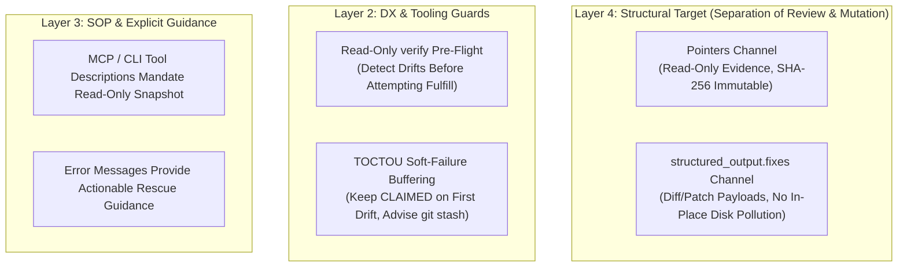

# ADR-0004: Separation of Review and Mutation (SRM), TOCTOU Soft-Failure Buffering, and Read-Only Baseline Protocol

- **Status**: Accepted
- **Date**: 2026-10-23
- **Authors**: Guo Qiang (GuoBug), Antigravity Engine, WorkBuddy Multi-Model Team
- **Context**: Real-world collision incident in contract `fc_1792755474459_099b018e` and architecture consensus in `fc_1792757763323_a5d5da12`

---

## 1. Context & Incident Post-Mortem

During the Phase A final verification of FerryCat, a critical multi-agent write collision occurred:

1. **The Setup**: Requester (`antigravity`) dispatched a code audit contract locking SHA-256 fingerprints across 5 pointer files including `src/engine.ts`.
2. **The Action**: Reviewer (`workbuddy`) spotted 6 documentation and comment drifts regarding `release_contract` semantics. Being proactive, it directly patched those comments in the local working directory.
3. **The Collision**: Upon calling `fulfill_contract`, FerryCat's TOCTOU guard detected `src/engine.ts` size changed from 32,909 to 33,103 bytes. It immediately transitioned the contract to terminal `POINTER_STALE`, invalidating 30 minutes of deep review labor.

While the watchdog performed its deterministic duty ("never fulfill against mutated baseline"), it exposed a fundamental architectural tension:
**FerryCat had a single `pointers` channel burdened with two conflicting semantics**:
- **Semantic A: Evidence Anchor ("What I read")** $\to$ Must remain 100% immutable to prove what baseline was audited.
- **Semantic B: Deliverables ("What I changed")** $\to$ Inevitably mutates disk bytes.

Loosening pointer validation for mutable tasks ruins the `verified_sha256` audit trail. Hard-failing immediately causes severe friction when reviewers attempt helpful fixes.

---

## 2. Architectural Decisions: 4-Layer Evolution Model



### 2.1 Decision 1: Separation of Review and Mutation (SRM Protocol)
- **Rule**: In audit tasks (`code_review` / `architecture_audit`), reviewers must **never mutate files referenced in `pointers`**.
- **Fix Delivery Protocol**: Code fixes and patches must be delivered as patch/diff structures inside `structured_output.fixes`:
  ```json
  {
    "result_summary": "Audit passed cleanly. Included 2 suggested patches.",
    "structured_output": {
      "verdict": "approved_with_fixes",
      "fixes": [
        {
          "path": "src/engine.ts",
          "patch": "@@ -613,2 +613,4 @@ ...",
          "description": "Fix release semantics comment"
        }
      ]
    }
  }
  ```
- **Benefits**:
  1. `pointers` remain pristine, ensuring fulfill success and uncompromised audit trail.
  2. Requester retains full sovereignty to review, apply, reject, or adjust the proposed diffs.
  3. **Zero engine code modifications**: `structured_output` is already a freeform JSON record.

### 2.2 Decision 2: DX Pre-Flight & TOCTOU Soft-Failure Buffering
- **Read-Only Verification**: Phase B will expose a non-destructive `ferrycat verify` or pre-flight check so workers can verify file hygiene before submitting.
- **Soft-Failure Buffering**: First-time TOCTOU mismatches should return a recoverable error keeping the contract `CLAIMED`, allowing the worker to `git stash` and retry fulfill without aborting the contract.

### 2.3 Decision 3: Actionable Error Messages (P0)
- Error messages must explicitly suggest recovery paths:
  > `TOCTOU_MISMATCH: pointers were modified on disk during execution. If unintentional, restore/stash files and retry fulfill; if you have fixes to deliver, provide them via structured_output.fixes instead of mutating workspace files directly.`

---

## 3. Consequences

### Positive
- Eliminates accidental contract invalidation during audit sessions.
- Preserves the purity of `verified_sha256` as true baseline proof.
- Standardizes patch structures for upcoming **FC-202 (Self-Contained Git Patch Mode)**.

### Trade-offs
- Reviewers cannot directly edit and commit files in-place during review contracts. They must provide diffs in structured output for the requester to apply.
