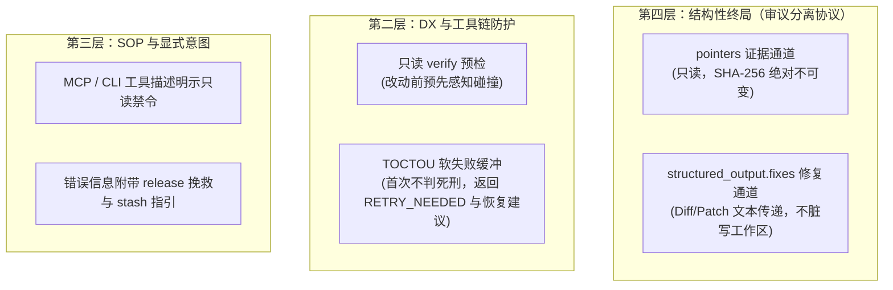

# ADR-0004: 审议分离协议、TOCTOU 软失败缓冲与审查期不可变基线规范

- **状态**: Accepted（针对 `implementation` / `test_generation` 变更型任务的交单语义已由 [ADR-0006](0006-dual-track-mutation-fulfillment_zh.md) 修订扩展）
- **日期**: 2026-10-23
- **作者**: Guo Qiang (GuoBug), Antigravity Engine, WorkBuddy Multi-Model Team
- **上下文**: Phase A 终审阶段 `fc_1792755474459_099b018e` 实战事故与 `fc_1792757763323_a5d5da12` 架构共识

---

## 1. 背景与实战事故还原 (Context & Real-World Incident)

在 FerryCat v0.1.1 演进至 v0.2.0（Phase A：生命周期与状态机纠偏）的终审验收中，发生了一起极具代表性的多 Agent 协作写冲突事故：

1. **事故现场**：发起方（Antigravity）派发代码审查工单，将目标文件 `src/engine.ts` 等 5 个文件作为 `pointers` 锁定全文件 SHA-256 指纹；
2. **审查者动作**：审查方（WorkBuddy）在执行白盒审查时，敏锐发现了 `src/engine.ts` 注释与 MCP 工具描述中存在 6 处与最新状态机不符的描述性漂移，并作为审查产物的一部分顺手在工作区进行了直接修补；
3. **熔断后果**：当 WorkBuddy 调用 `fulfill_contract` 交付评审报告时，底层 TOCTOU 看门狗检测到 `src/engine.ts` 文件大小由 32,909 变为 33,103 字节，触发 `TOCTOU_SIZE_MISMATCH`，导致**该工单被直接判为终态 `POINTER_STALE` 废单**，半小时审查结论险些完全丢失。

看门狗忠实履行了“拒绝在被变动代码上交单”的确定性底线，但这一事故揭露了 FerryCat 底层的一个核心设计矛盾：
**当前架构仅有 `pointers` 一条单一通道，却被迫承载了两种互斥的语义**：
- **语义 A：证据锚点（“我读过什么”）** $\to$ 必须绝对不可变，以证明审查意见对应哪一份基线快照；
- **语义 B：交付产物（“我改了什么”）** $\to$ 必然在磁盘上产生写入变动。

若简单粗暴地按任务类型放宽 pointers 校验，会导致 `verified_sha256` 退化为交单瞬间的无意义快照，破坏 cross-model 审计链；若一刀切禁止改动并硬失败处决，则导致审查者的实质性修补工作彻底报废。

---

## 2. 核心架构决策：四层演进规约 (Architectural Decisions)

经过 Antigravity 与 WorkBuddy 团队的深度交叉探针研讨，达成以下核心决议：



### 2.1 决策一：确立“审议分离协议”（Separation of Review and Mutation）
- **核心规约**：审查类任务（`code_review` / `architecture_audit`）中，持单者**严禁直接修改 `pointers` 锁定的工作区源文件**。
- **修复传递标准**：持单者发现的代码缺陷或优化方案，统一作为 Patch/Diff 文本装载进 `structured_output.fixes` 字段进行交付：
  ```json
  {
    "result_summary": "审查通过，发现 2 处潜在空指针隐患并附带修复 Patch",
    "structured_output": {
      "verdict": "approved_with_fixes",
      "fixes": [
        {
          "path": "src/engine.ts",
          "patch": "@@ -613,2 +613,4 @@ ...",
          "description": "修复 release 时错误描述漂移"
        }
      ]
    }
  }
  ```
- **架构优势**：
  1. `pointers` 全程保持干净，`fulfill_contract` 100% 成功，审计链完整；
  2. 发起方（Requester）拥有对 Diff 的审查、采纳、拒绝与二次合并的绝对主权，而非面对被破坏的事实现场；
  3. **引擎底层 0 改动**：现有 `structured_output` 本身为泛型 JSON 契约，天然向后兼容。

### 2.2 决策二：DX 层引入 Pre-flight 预检与 TOCTOU 软失败缓冲
- **只读预检命令**：在 Phase B 中提供 `ferrycat verify` 或在工具调用前暴露非破坏性探测，持单者可在交单前检查当前工作区是否与工单基线一致。
- **软失败缓冲机制**：`fulfill_contract` 遇到 TOCTOU 指针变动时，不再一击必杀直接更新为 `POINTER_STALE` 终态，而是提供有界的软失败机制（如首次返回可恢复的错误并保留 `CLAIMED` 状态），允许持单者通过 `git stash` 还原文件后再次交付。

### 2.3 决策三：错误信息与 MCP 描述注入可操作指引（P0 级）
- 在 `poll_next_task` 与 `fulfill_contract` 的 MCP 工具描述中明确声明只读约束；
- 当触发 TOCTOU 拒绝时，错误信息中必须包含明确的救济步骤：
  > `TOCTOU_MISMATCH: pointers were modified on disk during execution. If unintentional, restore/stash files and retry fulfill; if you have fixes to deliver, provide them via structured_output.fixes instead of mutating workspace files directly.`

---

## 3. 结果与影响 (Consequences)

### 正向收益 (Positive)
1. **杜绝废单悲剧**：彻底消除了由于审查者“好心修错”或误触文件导致的半小时级审查劳动成果报废；
2. **审计链绝对确定**：坚持了 `pointers` 证据锚点的纯粹性与不可篡改性，`verified_sha256` 始终忠实代表“审查基线”；
3. **平滑演进 FC-202**：`structured_output.fixes` 为后续路线图中的 **FC-202（可选 Git Patch 自包含模式）** 奠定了标准化数据结构。

### 限制与代价 (Trade-offs)
- 审查者不能随手在本地 IDE 中热修并直接提交 commit，必须先交单、再应用 patch（或由发起方合并），稍微增加了一步应用 diff 的步骤，但换取了跨 Agent 协作的最高安全级别。

---

## 4. 附录：核心生命周期状态迁移与契约不变量说明 (Lifecycle Invariants Note)

在 Phase A / B 联合审计与验证中，针对以下两处核心状态契约设计原则确立了明确共识：

1. **`release_contract` 为何保留 `retry_count`（防止配额洗白）**：
   - 当工单由持单方主动退回队列（`CLAIMED → SUBMITTED`）时，`extend_count` 会被清零（因为续期是针对当前认领者的执行期心跳预算），但**必须严格保留 `retry_count`**。
   - 核心原因：Schema 校验失败熔断（`max_retries = 2`）属于**工单级别（Contract-Level）的系统级防御配额**。如果释放退回可以重置 `retry_count`，恶意或死循环 Worker 就可以通过“格式错误 $\to$ 退单 $\to$ 重抢 $\to$ 格式错误”无休止洗白配额，从而破坏系统的确定性与熔断保护。
2. **`extend_ttl` 采用严格大于号校验（`proposedExpiresAt > lifetimeDeadline`）**：
   - 续期判断必须使用严格大于号而非大于等于号。若续期提议的到期时刻恰好等于绝对生命周期截止点（`proposedExpiresAt === lifetimeDeadline`），该次续期应当被合法接纳；只有当续期提议企图突破绝对生命周期上限（`>`）时才予以拒绝，从而严格捍卫绝对生命期上限的同时不错杀临界续期。
3. **`release_contract` 为何必须清零 `toctou_strike`（持有者级配额隔离）**：
   - `toctou_strike` 与 `extend_count` 同属于**持有者级别（Holder-Level）的状态量**，而非契约级别熔断配额。它衡量的是“当前持有者在本次审议执行期间是否处于被阻止状态”。
   - 若持单方 A 在审议期间因误碰文件产生 Strike 1 并主动退单释放，后续认领该工单的持单方 B 不应背负 A 的历史违规记录。将 `toctou_strike` 清零确保了退单释放作为“抢救手段”的真实有效性，避免无辜的下一位 Worker 因继承前任 Strike 而在任何轻微文件变动下被直接终态判死。
